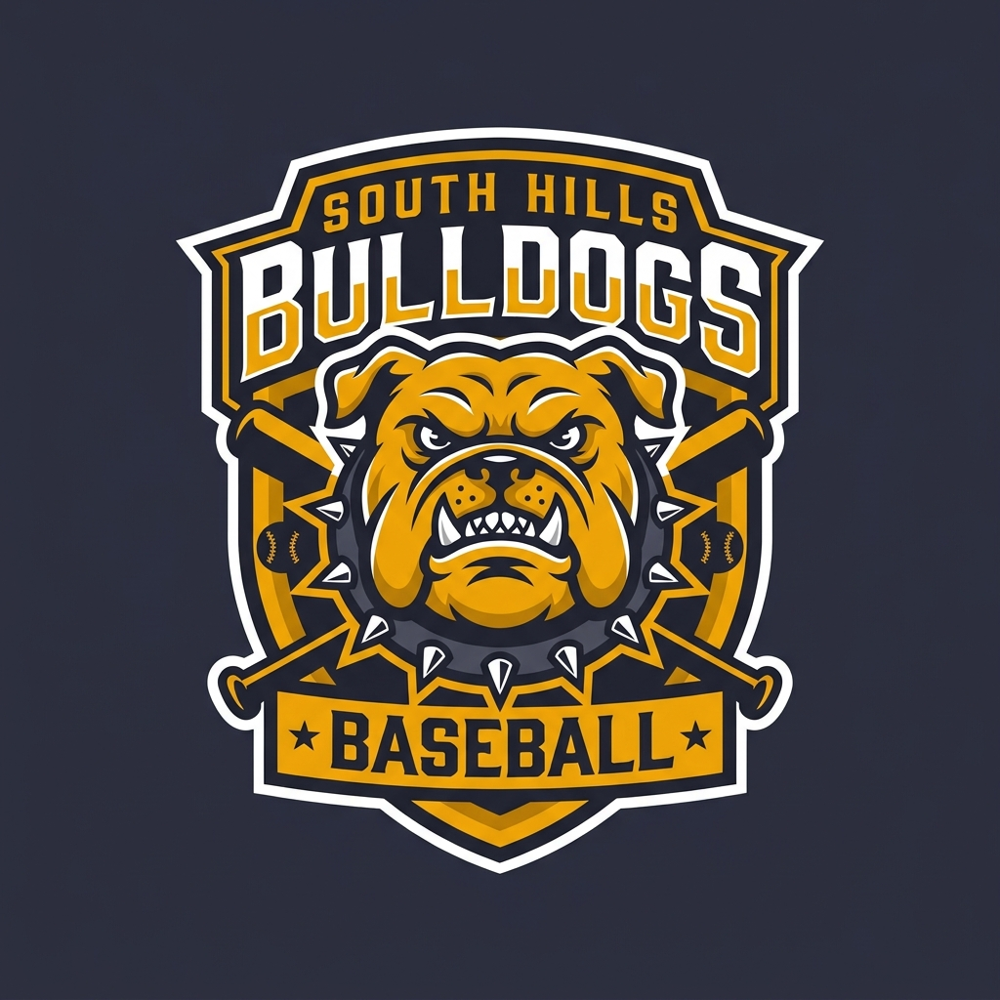
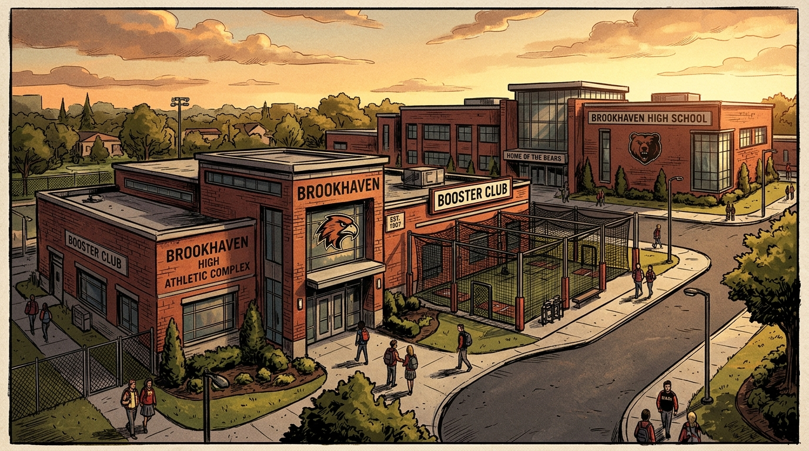
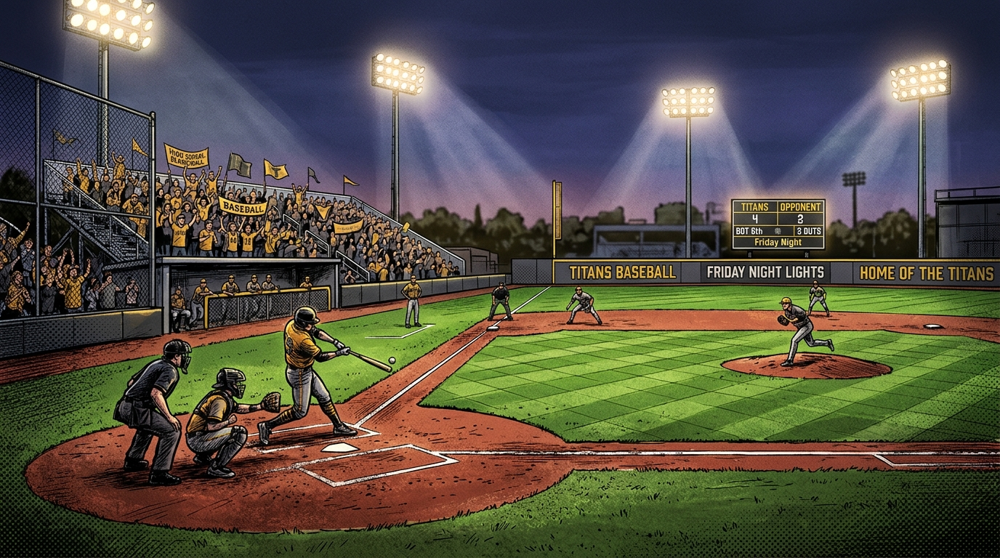
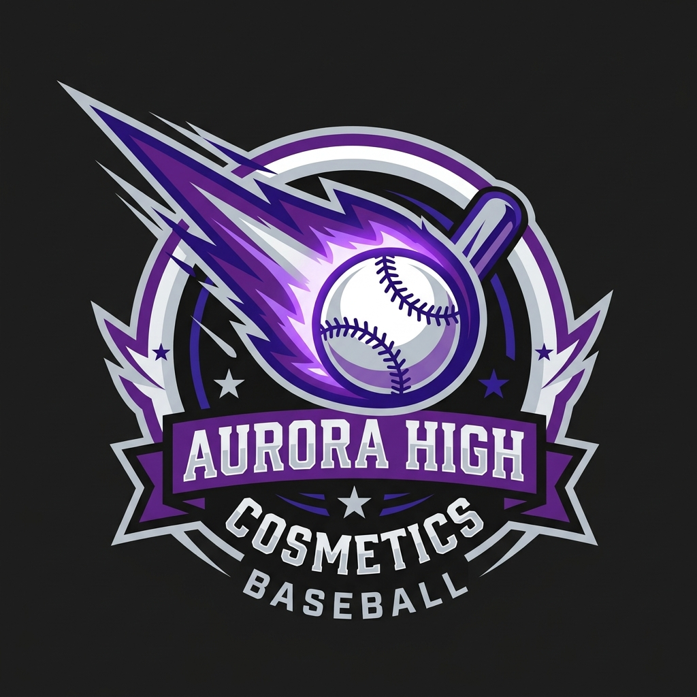
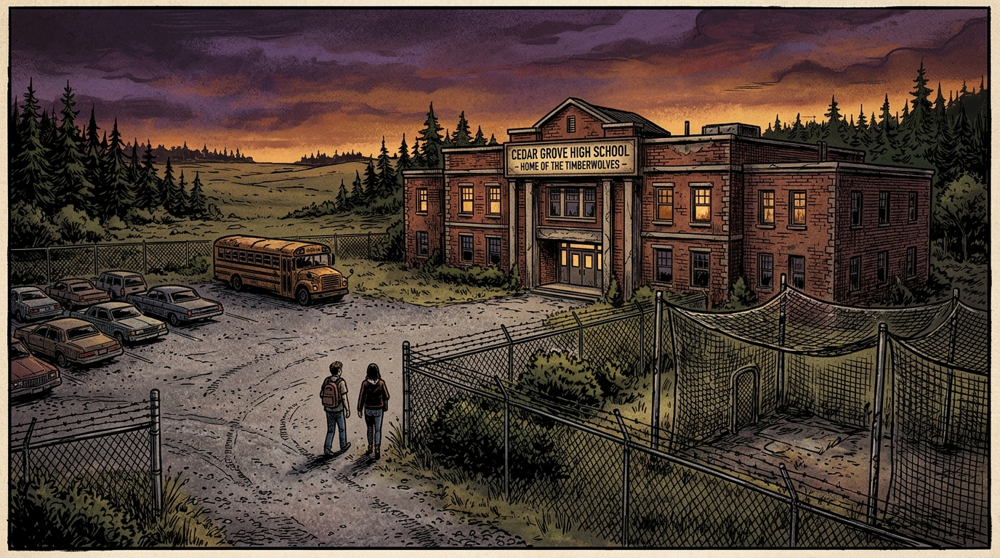

# Dirt & Diamonds — Asset Generation Progress & Catalog

## 1. Executive Summary

Asset generation has commenced in accordance with the project's gritty visual identity and art direction directives:

- **Logos & Crests (1:1 Aspect Ratio):** Clean, aggressive sports emblem / crest badges with flat 2D vector aesthetics, sharp silhouettes, bold outlines, and the team's canonical color palette, isolated on a dark background.
- **Venues & School Scenes (16:9 Aspect Ratio):** Gritty graphic-novel and motion-comic aesthetic with atmospheric lighting, hand-inked linework, and textured shading.

### Quota Status Notice

During generation of the Cedar Grove Comets field asset, the image generation backend returned:

```text
429 Too Many Requests: RESOURCE_EXHAUSTED
Model: gemini-3.1-flash-image
Quota reset scheduled for: 2026-10-26T00:40:25Z (~4h 50m)
```

Generation will resume immediately once this capacity window clears.

---

## 2. Completed & Integrated Engine Assets

All generated assets are converted to PNG and saved directly to [`Assets/Graphics/HighSchools/`](../../Assets/Graphics/HighSchools):

| Team | Asset | Target Path | Resolution / Style | Status |
| :--- | :--- | :--- | :--- | :--- |
| **Brookhaven Bulldogs (`BRK`, 105)** | Logo | [`Assets/Graphics/HighSchools/BRK_logo.png`](../../Assets/Graphics/HighSchools/BRK_logo.png) | 1:1 Vector Emblem | **Integrated** |
| | School | [`Assets/Graphics/HighSchools/BRK_school.png`](../../Assets/Graphics/HighSchools/BRK_school.png) | 16:9 Graphic Novel | **Integrated** |
| | Field | [`Assets/Graphics/HighSchools/BRK_field.png`](../../Assets/Graphics/HighSchools/BRK_field.png) | 16:9 Friday-Night Lights | **Integrated** |
| **Cedar Grove Comets (`CDG`, 106)** | Logo | [`Assets/Graphics/HighSchools/CDG_logo.png`](../../Assets/Graphics/HighSchools/CDG_logo.png) | 1:1 Vector Crest | **Integrated** |
| | School | [`Assets/Graphics/HighSchools/CDG_school.png`](../../Assets/Graphics/HighSchools/CDG_school.png) | 16:9 Graphic Novel | **Integrated** |
| | Field | `Assets/Graphics/HighSchools/CDG_field.png` | 16:9 Twilight Diamond | *Pending Quota* |

---

## 3. Visual Showcase of Generated Assets

### Brookhaven Bulldogs (`BRK`)


*Brookhaven Bulldogs Athletic Crest Badge — Athletic Gold (`#F2A900`) & Charcoal Gray (`#2B2D42`)*


*Brookhaven High Suburban Athletic Complex & Outdoor Cages*


*Brookhaven Diamond under Friday-Night Stadium Floodlights*

---

### Cedar Grove Comets (`CDG`)


*Cedar Grove Comets Speed-Trail Baseball Crest — Royal Purple (`#5A2D82`) & Silver Mist (`#C4C8D0`)*


*Cedar Grove High Rural Campus in Pine Barrens at Sunset*

---

## 4. Step 1 Queue: High School Remaining Assets

### Full Packages

1. **Cedar Grove Comets (`CDG`, ID 106) — Field:**
   - **Target:** `Assets/Graphics/HighSchools/CDG_field.png`
   - **Prompt:** `"High school baseball field diamond of Cedar Grove Comets, rural ballfield with wooden purple outfield fence, prairie wind whipping across center field grass, rustic wooden light poles and evening floodlights glowing against twilight sky, red clay infield dirt, small wooden bleachers, gritty graphic novel comic illustration style, textured hand-inked crosshatching, dramatic shadows."`
2. **Granite Falls Gators (`GRF`, ID 111):**
   - **Colors:** Kelly Green (`#008344`), Granite Gray (`#4B5563`), Bone White (`#F4F1EA`)
   - `grf_logo` (1:1): `"High school baseball athletic team logo of an aggressive alligator head snapping a baseball between vicious jaws, bold vector emblem crest badge, primary kelly green #008344 and secondary granite gray #4B5563 with bone white accents, sharp clean vector contours, modern varsity sports branding, isolated on dark charcoal background, 1:1 square vector."`
   - `grf_school` (16:9): `"High school campus exterior of Granite Falls High, gritty graphic novel motion-comic style, rough quarry-stone architecture, industrial mill town campus, raw mud along the edges, overcast cold March sky, rusted chainlink fence, hand-inked linework with crosshatching."`
   - `grf_field` (16:9): `"Granite Falls High baseball field diamond, quarry pit visible in the distant background, damp March red-clay infield, weathered stone backstop wall, dark green outfield fence, overcast dramatic lighting, gritty graphic novel style."`
3. **Hillcrest Hurricanes (`HLC`, ID 112):**
   - **Colors:** Cobalt Blue (`#0047AB`), Storm White (`#F0F4F8`), Crimson Red (`#C62828`)
   - `hlc_logo` (1:1): `"High school baseball athletic team logo of a swirling violent hurricane storm vortex wrapped around a baseball, bold vector emblem crest badge, primary cobalt blue #0047AB and storm white #F0F4F8 with crimson red accents, aerodynamic sharp contours, modern varsity sports branding, isolated on dark charcoal background, 1:1 square vector."`
   - `hlc_school` (16:9): `"Hillcrest High School campus, elevated exurban school built on windy ridge slopes, turbulent dramatic storm clouds looming above, modern architectural wings, swaying windblown trees, gritty motion-comic graphic novel style."`
   - `hlc_field` (16:9): `"Hillcrest High baseball field on a windy ridge terrace overlooking distant valley below, dramatic blustery weather, vibrant cobalt blue outfield wall with wind gauges, electric twilight floodlights, gritty hand-inked graphic novel style."`

### Standalone HS Logos (1:1 Vector Emblems)

- **Fairview Falcons (`FRV`, ID 103):** Navy Blue (`#1F2A44`) & Brushed Silver (`#B7BCC4`) — Diving predatory falcon raptor with sharp talons.
- **Oak Ridge Owls (`OKR`, ID 104):** Forest Green (`#1E4D2B`) & Old Gold (`#C5A253`) — Aggressive nocturnal horned owl head crest.
- **Pinehurst Panthers (`PNH`, ID 107):** Matte Black (`#14151A`) & Royal Purple (`#5B2A86`) — Sleek prowling panther profile with glowing eyes.
- **Westfield Warhawks (`WSF`, ID 108):** Maroon (`#6E1423`) & Steel Gray (`#6B7280`) — Military-styled stylized warhawk raptor emblem.
- **Summit Spartans (`SMT`, ID 109):** Slate Blue (`#38618C`) & Burnished Bronze (`#B08D57`) — Ancient Spartan warrior helmet crest.
- **Riverton Rams (`RVT`, ID 110):** River Teal (`#0E7C7B`) & Vegas Gold (`#C5B358`) — Charging bighorn ram with curled horns.

---

## 5. Step 2 Queue: College League Logo Catalog (24 Teams)

Prompt template:

`"Collegiate baseball athletic team logo of [mascot/emblem], bold vector emblem crest, primary [Primary Color Name] [Hex] and secondary [Secondary Color Name] [Hex] with [Accent] accents, clean aggressive varsity sports branding, sharp contours, isolated on dark charcoal background, 1:1 square vector."`

### College East Conference

#### Coastal Division

1. **ASH (201) — Ashford State Admirals:** Navy (`#0C2340`) & Maritime Gold (`#D4AF37`) — Naval admiral bicorne hat and anchor.
2. **BLV (202) — Blue Valley Bison:** Valley Blue (`#1E3A8A`) & Dusty Ochre (`#D97706`) — Charging mountain bison head.
3. **GLH (203) — Glenhaven Gulls:** Atlantic Slate (`#334155`) & Safety Orange (`#EA580C`) — Aggressive coastal seagull in flight.
4. **SMS (204) — Saltmarsh State Stingrays:** Marsh Green (`#14532D`) & Sandy Bronze (`#92400E`) — Gliding coastal stingray with barb.

#### Capital Division

1. **CVT (205) — Carverton Tech Chargers:** Circuit Blue (`#0284C7`) & Industrial Charcoal (`#1E293B`) — Lightning bolt and turbine energy crest.
2. **DNM (206) — Dunmore Dukes:** Royal Crimson (`#881337`) & Antique Brass (`#B45309`) — Noble coronet crest with crossed bats.
3. **MRB (207) — Marbury Miners:** Anthracite Black (`#18181B`) & Canary Gold (`#EAB308`) — Crossed pickaxes and miner's lamp.
4. **WXF (208) — Wexford Wildcats:** Pine Green (`#064E3B`) & Athletic Gold (`#F59E0B`) — Growling wildcat head with sharp fangs.

#### Valley Division

1. **LRV (209) — Lorain Valley Lancers:** Burgundy (`#4C0519`) & Steel Gray (`#475569`) — Knight helmet with jousting lance.
2. **NGT (210) — Northgate Nighthawks:** Midnight Blue (`#0F172A`) & Gunmetal (`#334155`) — Swooping nocturnal nighthawk raptor.
3. **UNM (211) — Union Mills Millers:** Wheat Tan (`#D97706`) & Millstone Gray (`#52525B`) — Millstone and wheat sheaf emblem.
4. **VNC (212) — Vance County Vipers:** Olive Drab (`#365314`) & Copperheads Rust (`#C2410C`) — Coiled striking viper snake.

### College West Conference

#### Lakes Division

1. **ELU (213) — Eastlake Eagles:** Ice Blue (`#38BDF8`) & Deep Navy (`#0369A1`) — Screaming bald eagle profile.
2. **MAM (214) — Midland Mavericks:** Maroon (`#831843`) & Tan Leather (`#B45309`) — Unbranded wild stallion bust.
3. **KSS (215) — Kessler State Kodiaks:** Grizzly Brown (`#451A03`) & Nordic Gold (`#CA8A04`) — Roaring Kodiak grizzly bear.
4. **YKP (216) — York Plains Pioneers:** Prairie Gold (`#EAB308`) & Barn Red (`#991B1B`) — Pioneer ox wagon and frontier axe.

#### Frontier Division

1. **FTG (217) — Fort Garland Grizzlies:** Mountain Charcoal (`#1F2937`) & Evergreen (`#15803D`) — Mountain grizzly silhouette and pine ridge.
2. **HOL (218) — Hollis Hawks:** Crimson (`#9F1239`) & Prairie Dust Tan (`#A16207`) — Fierce red-tailed hawk raptor.
3. **OXB (219) — Oxbow A&M Otters:** River Brown (`#573A1B`) & Riverbed Aqua (`#0D9488`) — Sleek athletic river otter head.
4. **RST (220) — Redstone Tech Rockets:** Aerospace Titanium (`#334155`) & Crimson Rocket (`#BE123C`) — Retro-futuristic rocket booster launching upward.

#### Canyon Division

1. **PLC (221) — Pell City Pilots:** Sand Dune (`#D97706`) & Horizon Blue (`#0284C7`) — Aviator wings and propeller motif.
2. **QRH (222) — Quarry Hill Quarrymen:** Sandstone Ochre (`#C2410C`) & Slate Basalt (`#334155`) — Sledgehammer and chiseled sandstone block.
3. **TOL (223) — Tolland Timberwolves:** Timber Green (`#166534`) & Wolf Gray (`#64748B`) — Howling timberwolf head profile.
4. **ZNR (224) — Zion Ridge Zephyrs:** Canyon Terra Cotta (`#9A3412`) & Mesa Gold (`#D97706`) — Canyon wind gust vortex and desert sun.

---

## 6. Step 3 Queue: Pro League Franchise Crest Catalog (32 Franchises)

Prompt template:

`"Major professional baseball franchise logo of [mascot/theme], premier sports team crest badge, primary [Primary Color Name] [Hex] and secondary [Secondary Color Name] [Hex] with [Accent] trim, bold clean vector art, pro club identity, isolated on solid dark charcoal background, 1:1 square vector."`

### Pro East Conference

#### Northeast Division

1. **BAY (301) — Bayport Barons:** Navy (`#0A192F`) & Antique Brass (`#C5A059`) — Aristocratic crest with harbor anchor.
2. **KBR (302) — Kingsbridge Krakens:** Abyssal Teal (`#0F4C5C`) & Tentacle Crimson (`#9A031E`) — Mythical sea kraken tentacle curling a baseball.
3. **HBV (303) — Harborview Herons:** Atlantic Steel (`#475569`) & Harbor Seafoam (`#2DD4BF`) — Elegant striking heron wading bird.
4. **SCR (304) — Scranton Steamers:** Locomotive Black (`#18181B`) & Steam Whistle Brass (`#D97706`) — Steam locomotive cowcatcher and gear.

#### Atlantic Division

1. **CLT (305) — Charlotte Crowns:** Royal Emerald (`#065F46`) & Sovereign Gold (`#EAB308`) — Regal sovereign crown with diamond jewels.
2. **DRM (306) — Durham Drakes:** Hunter Green (`#14532D`) & Mallard Gold (`#CA8A04`) — Iridescent mallard drake waterfowl head.
3. **RNK (307) — Roanoke Ridgerunners:** Blue Ridge Charcoal (`#1E293B`) & Mountain Fog (`#94A3B8`) — Moonshine bootlegger car / mountain trail runner.
4. **PLM (308) — Palmetto Pelicans:** Deep Carolina Navy (`#1E3A8A`) & Marsh Bronze (`#92400E`) — Coastal brown pelican scoop beak.

#### Great Lakes Division

1. **IRV (309) — Ironvale Foxes:** Foundry Orange (`#C2410C`) & Slag Iron (`#27272A`) — Cunning red fox head emerging from molten forge.
2. **TLD (310) — Toledo Titans:** Cobalt Blue (`#1D4ED8`) & Industrial Bronze (#B45309) — Colossal industrial warrior helmet.
3. **GLN (311) — Galena Gliders:** Galena Lead Gray (`#334155`) & Sky Streamer Teal (`#0D9488`) — Streamlined aerodynamic glider wings.
4. **NRW (312) — Norwood Nailers:** Hardened Steel (`#475569`) & Hammer Maroon (`#881337`) — Heavy forge hammer driving railway spikes.

#### Gulf Division

1. **HTB (313) — Hattiesburg Hornets:** Stinger Yellow (`#EAB308`) & Pitch Black (`#09090B`) — Fierce attacking hornet with stinger forward.
2. **CHT (314) — Chattahoochee Catfish:** Muddy River Brown (`#451A03`) & Catfish Whisker Gold (`#D97706`) — Whiskered river catfish emblem.
3. **KNP (315) — Kannapolis Knights:** Armor Silver (`#94A3B8`) & Royal Navy (`#1E3A8A`) — Plate-armored knight helm with plume.
4. **LRD (316) — Laredo Lobos:** Desert Sand (`#D97706`) & Border Night Charcoal (`#1C1917`) — Howling desert timberwolf silhouette.

### Pro West Conference

#### Plains Division

1. **OMA (317) — Omaha Outlaws:** Bandit Black (`#18181B`) & Prairie Rust (`#9A3412`) — Masked outlaw bandit with crossed revolvers/bats.
2. **CDR (318) — Cedar Rapids Colts:** Prairie Navy (`#1E3A8A`) & Chestnut Brown (`#78350F`) — Rearing young wild colt horse.
3. **SXB (319) — Sioux Bend Storm:** Stormcloud Slate (`#334155`) & Lightning Cyan (`#06B6D4`) — Thunderhead cloud crackling with dual lightning bolts.
4. **TWF (320) — Twin Forks Trout:** Riverbed Olive (`#3F6212`) & Rainbow Trout Copper (`#C2410C`) — Leaping spotted rainbow trout.

#### Mountain Division

1. **BZM (321) — Bozeman Bighorns:** Granite Peak (`#334155`) & Horn Gold (`#CA8A04`) — Massive curled bighorn sheep ram skull.
2. **PRV (322) — Provo Prospectors:** Wasatch Navy (`#0F172A`) & Gold Nugget (`#EAB308`) — Pickaxe-wielding gold prospector bust.
3. **ABQ (323) — Albuquerque Aviators:** Turquoise (`#0D9488`) & Desert Sun Copper (`#C2410C`) — High-altitude supersonic jet wings with sunburst.
4. **DST (324) — Dustfield Drifters:** Dust Ochre (`#A16207`) & Oil Slick Black (`#18181B`) — Dust devil whirlwind over tumbleweed desert.

#### Southwest Division

1. **MRJ (325) — Mesa Roja Rattlers:** Terracotta Red (`#991B1B`) & Copper Sand (`#D97706`) — Coiled diamondback rattlesnake baring fangs.
2. **SBW (326) — Sablewood Stallions:** Midnight Black (`#0A0A0A`) & Saddle Gold (`#CA8A04`) — Fierce black thoroughbred stallion stallion.
3. **FRS (327) — Fresno Firebirds:** Inferno Crimson (`#B91C1C`) & Flare Orange (`#EA580C`) — Flaming phoenix rising with fiery baseball.
4. **MDS (328) — Modesto Mustangs:** Royal Blue (`#1D4ED8`) & Golden Straw (`#EAB308`) — Galloping valley mustang horse with windblown mane.

#### Pacific Division

1. **SLK (329) — Silverlake Sharks:** Chrome Silver (`#94A3B8`) & Ocean Deep Navy (`#0F172A`) — Great white shark head surfacing with open jaws.
2. **CAS (330) — Cascadia Wolves:** Pacific Moss (`#166534`) & Rain Slate (`#475569`) — Pacific Northwest tribal-influenced timberwolf profile.
3. **TAC (331) — Tacoma Thunder:** Puget Navy (`#0C4A6E`) & Lightning Gold (`#FACC15`) — Thunderclap cloud with piercing lightning bolt.
4. **YBC (332) — Yuba City Yellowjackets:** Stinger Yellow (`#FACC15`) & Charcoal Black (`#18181B`) — Aggressive yellowjacket wasp stinger emblem.
